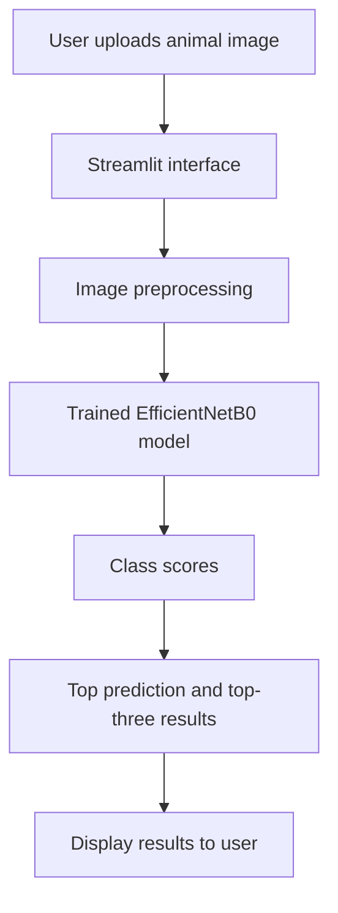

::: {align="center"}
# 🐾 AgroGuard AI

### Intelligent Animal Classification Using Deep Learning

**A comparative deep-learning project evaluating five models for
multi-class animal image classification.**

*Upload an animal image, view the predicted class, and inspect the
top-three predictions.*
:::📌 Table of Contents
- Overview
- Features
- Live Demo
- Models and Results
- Dataset
- Architecture
- Repository Structure
- Run Locally
- Limitations
- Future Improvements
- License
🌿 Overview
AgroGuard AI is an animal image classification application built
with TensorFlow/Keras and Streamlit. It compares five trained
models---EfficientNetB0, DenseNet121, MobileNetV2, ResNet50, and a
custom CNN---using classification metrics, training time, and model
size.

The web app uses EfficientNetB0 to classify uploaded images and
displays the top-three class scores.
Best result in the recorded experiment: EfficientNetB0 achieved
97.55% test accuracy on the held-out test set.

✨ Features
- 🖼️ Upload an animal image through a simple web interface.
- 🎯 View the predicted class and top-three predictions.
- 🧠 Compare five deep-learning models.
- 📊 Review accuracy, macro precision, macro recall, and macro
  F1-score.
- 📈 Explore comparison charts and the EfficientNetB0 confusion
  matrix.
- ⚡ Run inference using the trained EfficientNetB0 model.
🚀 Live Demo
Open AgroGuard AI --- Streamlit App
If the hosted app does not load, the deployment may be restarting or
need its Python/dependency configuration updated. You can also run the
project locally using the instructions below.
🧠 Models and Results
  Model                    Accuracy        Macro Macro Recall        Macro   Training Model size
                                       Precision                  F1-score       time 
  EfficientNetB0     97.55%   97.55%   98.04%   97.77%   4.27 min   16.47 MB

  DenseNet121                97.33%       97.44%       97.57%       97.49%   3.82 min   28.47 MB

  MobileNetV2                96.22%       96.51%       96.75%       96.59%   2.13 min    9.40 MB

  ResNet50                   96.11%       96.17%       96.09%       96.10%   5.19 min   90.96 MB
  Custom CNN                 36.04%       31.72%       26.29%       23.97%   7.65 min    1.34 MB
📉 Model comparison charts
The charts are available in [`comparison_charts/`](comparison_charts/).
::: {align="center"}
**Accuracy** 

**Macro F1-score** 

**Model size** 

**Training time** 
:::
Key takeaway: EfficientNetB0 achieved the highest recorded accuracy
and macro F1-score. MobileNetV2 was the smallest transfer-learning model
in this comparison and had the shortest recorded training time. Results
can vary with hardware, data preprocessing, and training configuration.
🗂️ Dataset
The recorded dataset contains 9,084 images across 15 classes.

  Split             Images
  Training           7,262
  Validation           923
  Test                 899
  Total      9,084

Classes: Armadilles, Bear, Birds, Cow, Crocodile, Deer,
Elephant, Goat, Horse, Jaguar, Monkey, Rabbit, Skunk,
Tiger, Wild Boar.
Add the original dataset source, attribution, and license before
redistributing dataset content.

🏗️ Architecture

The other trained models are included for experimentation and
comparison. The Streamlit prediction flow uses
Models/efficientnetb0_best.keras.
📁 Repository Structure
AgroGuard-AI/
├── app.py
├── requirements.txt
├── .gitignore
├── Models/
│   ├── custom_cnn_best.keras
│   ├── densenet121_best.keras
│   ├── efficientnetb0_best.keras
│   ├── mobilenetv2_best.keras
│   └── resnet50_best.keras
├── comparison_charts/
│   ├── accuracy_comparison.png
│   ├── macro_f1_comparison.png
│   ├── model_size_comparison.png
│   └── training_time_comparison.png
├── results/
│   ├── custom_cnn_metrics.json
│   ├── densenet121_metrics.json
│   ├── efficientnetb0_metrics.json
│   ├── mobilenetv2_metrics.json
│   ├── resnet50_metrics.json
│   └── efficientnetb0_confusion_matrix.png
└── notebook/
    └── Jupyter nb.ipynb
⚙️ Run Locally
1. Clone the repository
git clone https://github.com/Shubham-css/AgroGuard-AI.git
cd AgroGuard-AI
2. Create and activate a virtual environment
Windows PowerShell
python -m venv .venv
.\.venv\Scripts\Activate.ps1
macOS / Linux
python3 -m venv .venv
source .venv/bin/activate
3. Install dependencies
Use a Python version supported by the TensorFlow version in
requirements.txt. Python 3.12 is a suitable option for the project's
TensorFlow 2.21.0 dependency.
python -m pip install --upgrade pip
pip install -r requirements.txt
4. Launch the app
streamlit run app.py
Open the local address shown in your terminal, usually
http://localhost:8501.
📈 Evaluation Snapshot
The recorded EfficientNetB0 evaluation reports: - Accuracy: 97.55% -
Macro precision: 97.55% - Macro recall: 98.04% - Macro
F1-score: 97.77% - Correct predictions: 877 of 899 test images

See
[`results/efficientnetb0_metrics.json`](results/efficientnetb0_metrics.json)
and
[`results/efficientnetb0_confusion_matrix.png`](results/efficientnetb0_confusion_matrix.png)
for saved evaluation artifacts.
⚠️ Limitations
- Performance depends on the quality and distribution of the training
  data.
- A high class score does not guarantee that an image belongs to a
  supported animal class.
- A confidence threshold can flag uncertain predictions, but it is
  not a complete unknown-class or out-of-distribution detector.
- Performance on external images may differ from the held-out test-set
  results.
🛣️ Future Improvements
- Implement and evaluate a dedicated unknown/out-of-distribution
  detection method.
- Add per-class metrics and a normalized confusion matrix.
- Document dataset provenance, preprocessing, and training settings.
- Add application screenshots or a short demo GIF.
- Add automated tests and a reproducible evaluation workflow.
🤝 Contributing
Suggestions and improvements are welcome.
1. Fork the repository.
2. Create a feature branch: git checkout -b feature/your-feature.
3. Commit your changes.
4. Push the branch and open a pull request.
📄 License
A license has not yet been specified. Add a LICENSE file and update
this section before explicitly permitting reuse or redistribution of the
code, models, or dataset.
::: {align="center"}
**Built with 🧠 TensorFlow · 🐍 Python · ⚡ Streamlit**

[🚀 Launch App](https://agroguard-ai-dl-lab-la-2.streamlit.app/) · [💻
GitHub Repository](https://github.com/Shubham-css/AgroGuard-AI)
:::