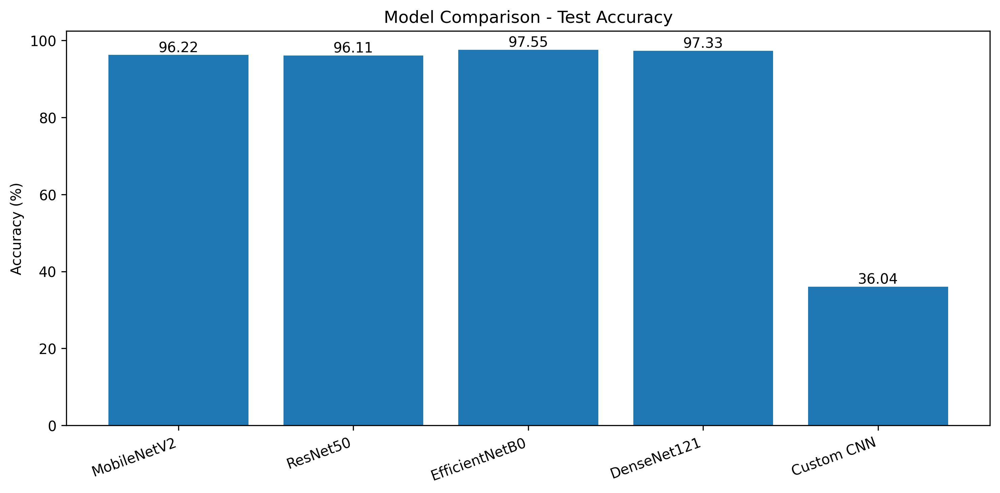
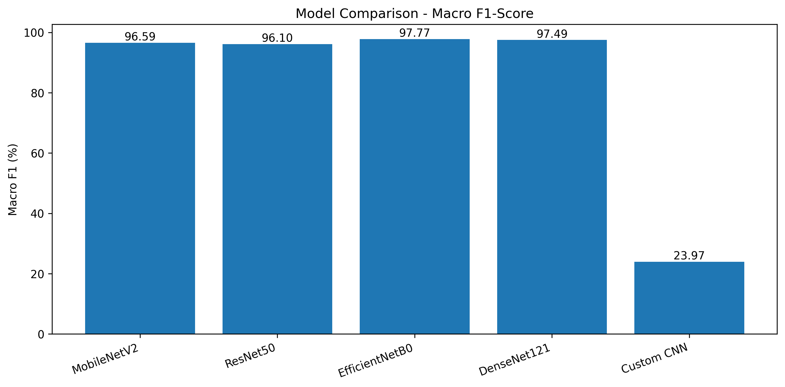
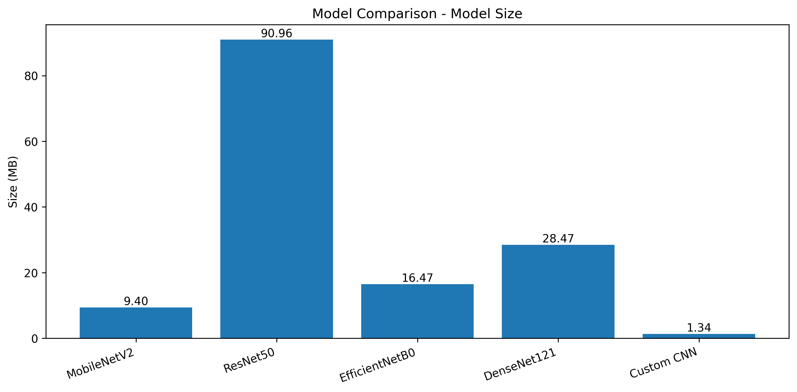
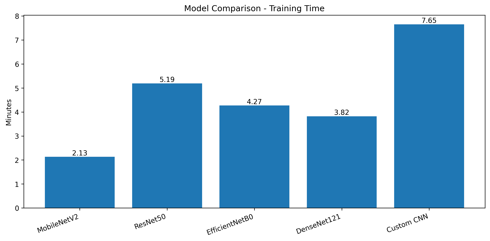

<div align="center">

# 🐾 AgroGuard AI

### Intelligent Animal Classification Using Deep Learning

**A comparative deep-learning project evaluating five models for multi-class animal image classification.**

[](https://agroguard-ai-dl-lab-la-2.streamlit.app/)
[](https://www.python.org/)
[](https://www.tensorflow.org/)
[](https://streamlit.io/)

*Upload an animal image, view the predicted class, and inspect the top-three predictions.*

</div>

---

## 📌 Table of Contents

- [Overview](#-overview)
- [Features](#-features)
- [Live Demo](#-live-demo)
- [Models and Results](#-models-and-results)
- [Dataset](#-dataset)
- [Architecture](#-architecture)
- [Repository Structure](#-repository-structure)
- [Run Locally](#-run-locally)
- [Evaluation Snapshot](#-evaluation-snapshot)
- [Limitations](#️-limitations)
- [Future Improvements](#-future-improvements)
- [Contributing](#-contributing)
- [License](#-license)

---

## 🌿 Overview

**AgroGuard AI** is an animal image classification application built with TensorFlow/Keras and Streamlit.

The project compares five trained models:

- EfficientNetB0
- DenseNet121
- MobileNetV2
- ResNet50
- Custom CNN

The application uses **EfficientNetB0** to classify uploaded images and displays the top-three class predictions.

> 🏆 **Best recorded test accuracy: 97.55% with EfficientNetB0.**

## ✨ Features

- 🖼️ Upload an animal image through a simple web interface.
- 🎯 View the predicted class and top-three predictions.
- 🧠 Compare five deep-learning models.
- 📊 Review accuracy, macro precision, macro recall, and macro F1-score.
- 📈 Explore model-comparison charts and a confusion matrix.
- ⚡ Run predictions using the trained EfficientNetB0 model.

## 🚀 Live Demo

### [🌐 Open AgroGuard AI — Streamlit App](https://agroguard-ai-dl-lab-la-2.streamlit.app/)

The application is hosted on Streamlit Community Cloud.

If the hosted app does not load, its deployment may need a runtime or dependency configuration update. You can also run the project locally using the instructions below.

---

## 🧠 Models and Results

The following table summarizes the recorded experimental results.

| Model | Accuracy | Macro Precision | Macro Recall | Macro F1-score | Training Time | Model Size |
|:--|--:|--:|--:|--:|--:|--:|
| **EfficientNetB0** | **97.55%** | **97.55%** | **98.04%** | **97.77%** | 4.27 min | 16.47 MB |
| DenseNet121 | 97.33% | 97.44% | 97.57% | 97.49% | 3.82 min | 28.47 MB |
| MobileNetV2 | 96.22% | 96.51% | 96.75% | 96.59% | 2.13 min | 9.40 MB |
| ResNet50 | 96.11% | 96.17% | 96.09% | 96.10% | 5.19 min | 90.96 MB |
| Custom CNN | 36.04% | 31.72% | 26.29% | 23.97% | 7.65 min | 1.34 MB |

### 📉 Model Comparison Charts

The charts are available in the [`comparison_charts/`](comparison_charts/) directory.

<div align="center">

### Accuracy Comparison



### Macro F1-score Comparison



### Model Size Comparison



### Training Time Comparison



</div>

### 🔍 Key Findings

- **EfficientNetB0** achieved the highest recorded accuracy and macro F1-score.
- **DenseNet121** also achieved strong classification performance.
- **MobileNetV2** offered a compact model size and the shortest recorded training time among the evaluated models.
- **ResNet50** achieved high accuracy but had the largest model size.
- The **Custom CNN** performed considerably worse than the transfer-learning models in this experiment.

These results describe this project's recorded evaluation. Performance and training time may vary with hardware, preprocessing, and training configuration.

---

## 🗂️ Dataset

The recorded dataset contains **9,084 images** across **15 animal classes**.

| Dataset Split | Number of Images |
|:--|--:|
| Training | 7,262 |
| Validation | 923 |
| Test | 899 |
| **Total** | **9,084** |


## 🏗️ Project Architecture

```mermaid
flowchart TD
    A["User uploads animal image"] --> B["Streamlit interface"]
    B --> C["Image preprocessing"]
    C --> D["Trained EfficientNetB0 model"]
    D --> E["Class scores"]
    E --> F["Top prediction and top-three results"]
    F --> G["Display results to user"]